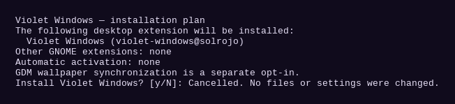
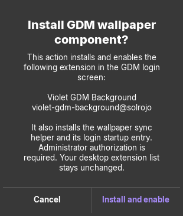

# Violet Windows

A GNOME Shell extension for window placement, keyboard focus, and the top bar.

- Opens new application windows on the monitor under the pointer. Initial window sizes are determined by GNOME and each application.
- Draws a violet border around the focused window, including standalone dialogs.
- Styles the native GNOME dash and Dash to Dock with a dark violet background, violet borders, and hover and keyboard-focus highlights.
- Uses matching violet hover and keyboard-focus highlights in the overview app grid and application folders.
- Styles the GNOME lock screen, including its clock, avatar, password field, and panel.
- Resizes the active window with **Super + Alt** and a left-button drag.
- Moves the pointer to the newly focused window when confirming Alt+Tab or using Zorin Tiling Shell's directional or sequential focus shortcuts.
- Dismisses Wofi when you click outside it and places application indicators to the left of System Monitor when that indicator is present.

## Screenshots

The installer transcript below shows the default cancellation path. The GDM screenshot is captured from the actual confirmation dialog; its test callback does not run an installer.





## Requirements

- GNOME Shell 46, the version declared by the extension.
- Zorin Tiling Shell for pointer movement with its keyboard focus shortcuts.
- Wofi and the GNOME System Monitor extension for their respective integrations. Both are optional.

## Installation

1. Download or clone this repository and open a terminal in its directory.
2. Run the installer as your regular desktop user.

   ```sh
   ./install.sh
   ```

The installer first lists **Violet Windows** (`violet-windows@solrojo`) and asks:

```text
Install Violet Windows? [y/N]:
```

Only `y` or `yes` installs it. No, empty input or EOF cancels before any files are changed. It does not install other desktop extensions and does not enable Violet Windows automatically. The GDM component remains a separate opt-in.

For a non-mutating preview or an explicit unattended installation:

```sh
./install.sh --dry-run
./install.sh --yes
```

`--yes` confirms installation of Violet Windows only; it does not enable GDM synchronization.

3. Log out and back in so GNOME Shell loads the files.
4. Enable **Violet Windows** in the **Extensions** app, or run:

   ```sh
   gnome-extensions enable violet-windows@solrojo
   ```

To update, run the installer again and log out and back in.

## Uninstallation

Disable the extension first so it can restore any temporarily suspended mouse modifier. Then remove its installation directory.

```sh
gnome-extensions disable violet-windows@solrojo
rm -r -- "${XDG_DATA_HOME:-$HOME/.local/share}/gnome-shell/extensions/violet-windows@solrojo"
```

## Optional GDM login theme

On Zorin OS with GNOME Shell 46, the separate GDM installer adds the violet clock, top bar, menus, dialogs, and avatar styling to the active greeter theme. It preserves that theme's background and other assets. The desktop extension installer handles the **Super+L** lock screen.

Install the required packages before applying the GDM theme:

```sh
sudo apt update
sudo apt install python3 libglib2.0-bin libglib2.0-dev-bin
```

The installer checks for missing commands before changing the theme. If a
dependency is missing, it prints the package installation command. The compiler
is needed for both `--check` and installation, including when applying the theme
from the preferences window.

After installing the extension, open **Extensions → Violet Windows → Preferences**.
Under **GDM login screen**, select **Apply** (or **Reapply** after an update) or **Restore previous**. The buttons use
`pkexec` to ask for administrator authorization. The theme takes effect the next time
GDM opens the login screen.

The same actions are available from the repository directory:

```sh
python3 install-gdm.py --check
sudo python3 install-gdm.py
sudo python3 install-gdm.py --restore
```

Restore the previous GDM theme before uninstalling the extension if you also want
to revert the login screen.

## Follow the desktop wallpaper in GDM

In Violet Windows preferences, select **Enable sync** under **Follow desktop
wallpaper**. A separate dialog lists **Violet GDM Background**
(`violet-gdm-background@solrojo`), the wallpaper helper and its login startup
entry. **Cancel** is the default response. Only **Install and enable** starts
administrator authorization. On a fresh Zorin installation,
this installs the GDM background component and the desktop wallpaper watcher.
The same setup is available from a terminal in the repository directory:

    sudo python3 install-gdm.py --sync-wallpaper

Terminal setup also lists those components and asks for an explicit `y`/`yes`
before any package installation or system writes. Empty input or EOF cancels.
For unattended setup, the deliberately explicit form is:

```sh
sudo python3 install-gdm.py --sync-wallpaper --yes
```

The `--yes` flag is accepted only with `--sync-wallpaper`; it does not silently
apply the GDM theme. The desktop extension list is preserved by synchronization.

The normal extension installer copies all synchronization files into the
installed extension directory. The synchronization setup requires administrator
access once. Each later wallpaper change is copied by the desktop user without
another administrator prompt.

The synchronizer follows the active light or dark wallpaper and monitors the
image file for replacements by Firefox or other applications. Local image files
are supported. GDM uses the latest PNG copy the next time its login screen opens,
with independent backgrounds on each monitor. The most recently configured user
supplies the shared GDM wallpaper.

## Reproducing the dock appearance

The dock styling supports the native GNOME dash and Dash to Dock. To reproduce
the desktop dock, install and enable Dash to Dock, import the matching dotfile
preferences, and disable Zorin Taskbar, Zorin Dash or Ubuntu Dock. The dotfiles
installer lists these changes and applies them only after your explicit selection
and separate dock-replacement approval. Restart the GNOME session after
installing extensions. Violet Windows preserves rounded corners, violet borders
and hover or focus highlights through its stylesheet.

## Installer consent tests

The tests verify cancellation before writes, explicit desktop installation into a temporary directory, and GDM consent before dependency commands or user lookup:

```sh
python3 -B -m unittest discover -s tests -p 'test_*.py' -v
```

The confirmation dialog can be tested on an isolated X11 display using GJS, Xvfb and a separate session bus:

```sh
GDK_BACKEND=x11 GTK_A11Y=none GSETTINGS_BACKEND=memory \
  dbus-run-session -- xvfb-run -a gjs -m tests/test_wallpaper_consent.js "$PWD"
```

The GUI test cancels and approves a harmless callback; it never runs `pkexec`, installs a component, or changes GDM settings.
